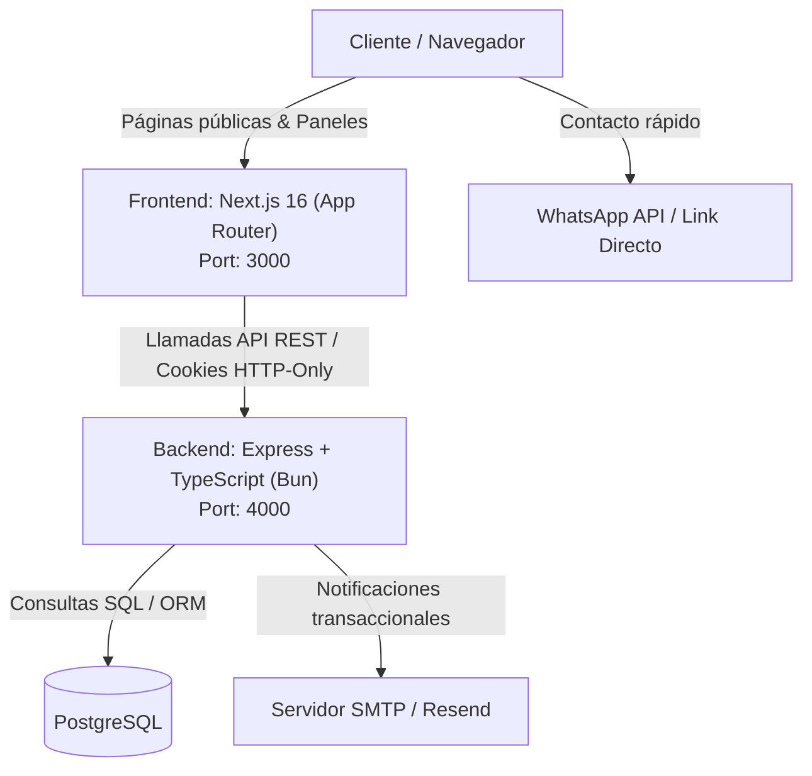
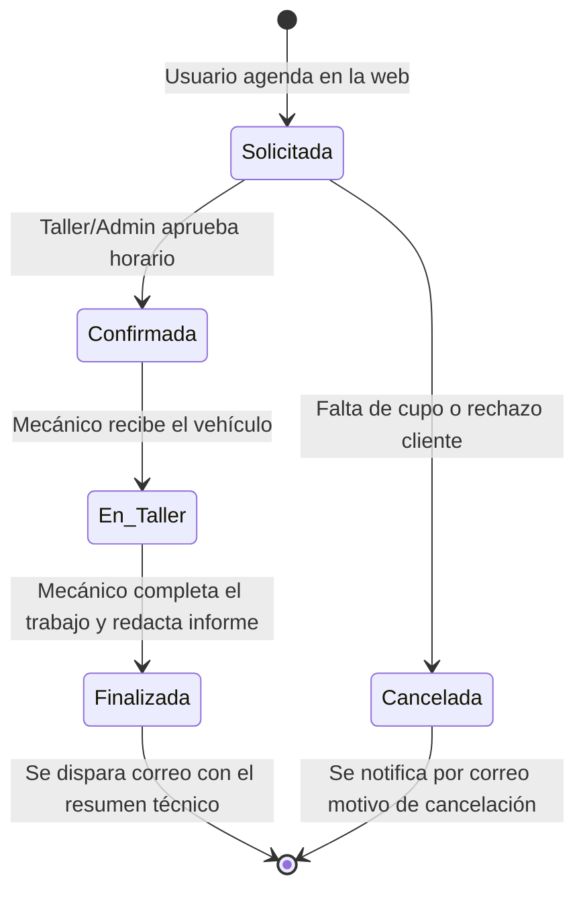

# Arquitectura del Sistema - Grúas Cares

Este documento describe la arquitectura global, patrones de diseño y flujo de datos para la plataforma web y sistema de gestión de Grúas Cares.

---

## 1. Visión General de la Solución

El sistema se compone de dos capas desacopladas sobre el runtime **Bun**:

---

## 2. Capas del Sistema

### 2.1. Frontend (Next.js 16)
- **Localización**: Raíz del proyecto (`/app`, `/public`, etc.).
- **Responsabilidad**: Presentación de la web corporativa, catálogo visual, agenda pública y los 3 portales/paneles (`/portal`, `/mecanico`, `/admin`).
- **Navegación & Seguridad**:
  - `proxy.ts` (Next 16) protege `/portal`, `/mecanico` y `/admin`: consulta `GET /api/auth/me` con la cookie `gc_token` y redirige por rol (`app/lib/route-guard.ts`). Si no puede verificar la sesión (sin cookie, inválida, revocada o backend caído) falla cerrado y envía a `/login?redirect=…`. Solo evita mostrar pantallas ajenas; la autorización de los datos la decide siempre el backend.
  - Contexto de autenticación en React (`AuthContext`) para actualizar estado en el cliente.
- **Estilos**: Sistema de diseño basado en la identidad oficial en `app/globals.css`.

### 2.2. Backend (Express + TypeScript)
- **Localización**: `/backend`.
- **Runtime**: Bun (máximo rendimiento y compatibilidad nativa con TypeScript sin necesidad de transpilación lenta).
- **Patrón de Arquitectura**: Capas (Controller -> Service -> Repository/ORM).
- **Seguridad**:
  - Helmet para cabeceras HTTP seguras.
  - CORS configurado exclusivamente para el dominio del frontend.
  - Rate limiting en login, registro, creación pública de citas y consulta de disponibilidad (`backend/src/middlewares/rate-limit.ts`, `express-rate-limit`, memoria del proceso):

    | Ruta | Límite |
    | :--- | :--- |
    | `POST /api/auth/login` | 10 intentos / 15 min por IP + correo, y 100 / 15 min por IP |
    | `POST /api/auth/register` | 10 / hora por IP |
    | `POST /api/appointments` (público) | 10 / hora por IP |
    | `GET /api/appointments/availability` | 60 / minuto por IP |

    Responde `429` con `Retry-After`. Detrás de un proxy hay que definir `TRUST_PROXY` para que `req.ip` sea la IP real. Con varias instancias del backend se debe migrar a un almacén compartido (Redis).
  - Passwords con `bcrypt` (costo 12, `BCRYPT_ROUNDS`), mínimo 8 caracteres y máximo 72 bytes; el login responde igual y tarda igual para "usuario inexistente" y "clave incorrecta", y una cuenta desactivada solo se informa a quien aporta la clave correcta.
  - CSRF: la cookie `gc_token` es `SameSite=Lax`, por lo que el navegador no la envía en peticiones POST/PATCH/DELETE originadas en otros sitios. Es suficiente mientras frontend y API compartan sitio (mismo dominio o `/api` por proxy de Next). Si se separan en sitios distintos habría que añadir un token CSRF o `SameSite=None` con protección adicional.
  - Listados de personal (`/api/mechanic/agenda`, `/api/vehicles`) paginados (`page`, `limit`, máximo 500).
  - Frontend: cabeceras de seguridad (CSP, X-Frame-Options, Referrer-Policy, Permissions-Policy, HSTS en producción) en `next.config.ts`.
  - Tokens JWT (HS256 fijado) en cookie `httpOnly`, `SameSite=Lax`, `Secure` en producción; el token **no** se devuelve en el cuerpo JSON.
  - Cada request autenticado se contrasta con la BD: el usuario debe existir y estar activo, el rol efectivo es el de la BD y `users.token_version` debe coincidir con el del token. Desactivar a un usuario, o `POST /api/auth/logout-all`, invalida sus sesiones de inmediato; cambiar sus roles no (se leen de la BD en cada request).

### 2.3. Base de Datos (PostgreSQL)
- **Migraciones**: el esquema vive en `backend/src/db/schema.ts` y los cambios se versionan en `backend/drizzle/`.
  1. Editar `schema.ts`.
  2. `bun run db:generate` (revisar y commitear el `.sql` generado).
  3. `bun run db:migrate` aplica las migraciones pendientes.

  No se usa `db:push` (se eliminó el script) porque deja la base sin rastro de cambios y desalineada de las migraciones.
  Si tu base local se creó antes con `db:push`, recréala: `docker compose down -v && docker compose up -d && bun run db:migrate && bun run db:seed`.
  Las pruebas (`bun run test` en `/backend`) crean `gruas_cares_test` desde cero aplicando las migraciones reales.
- **Modelos Principales**:
  - **`users`**: Administradores, mecánicos y clientes.
  - **`vehicles`**: Vehículos asociados a clientes (patente, marca, modelo, año, kilometraje).
  - **`services`**: Catálogo de servicios ofrecidos (grúa de rescate, cambio de aceite, mantención preventiva, etc.).
  - **`appointments`**: Citas y solicitudes con fechas, bloques horarios, estado del flujo y mecánico asignado.
  - **`service_records`**: Bitácora técnica post-atención (informe técnico, repuestos cambiados, recomendaciones).

---

## 3. Flujo de Estados de una Cita en Serviteca

El backend aplica estas transiciones (`backend/src/domain/appointment-status.ts`): `solicitada → confirmada | cancelada`, `confirmada → en_proceso | cancelada`, `en_proceso → finalizada`; `finalizada` y `cancelada` son finales. Cualquier otro cambio responde `409`. Finalizar exige informe técnico, que solo se registra con la cita en taller (o para corregirlo una vez finalizada); el correo al cliente se envía una única vez, al finalizar.

---

## 4. Política de Notificaciones
- **Notificaciones operativas y transaccionales**: Se realizan exclusivamente vía **correo electrónico** (creación de cuenta, confirmación de cita, cambio de estado, resumen de atención técnica).
- **Contacto comercial / emergencias inmediatas**: Se canaliza a través del **botón flotante de WhatsApp** en el frontend público para comunicación humana inmediata.
